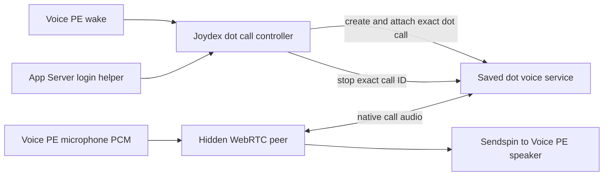

# Native Dot voice for Joydex and Voice PE

Compatibility baseline validated on 2026-10-11 against Windows package `26.1007.2314.0`,
app release `26.1007.21434` and Codex runtime `0.162.0-alpha.17.2`. Review updated on
2026-10-13.

Voice PE wake can start a native voice call with a saved dot. The device supplies microphone
and speaker audio through Joydex's existing hidden WebRTC media host and Sendspin transport.
There is no browser window or virtual Windows audio-device requirement. The route is experimental
and rejects an unvalidated Codex runtime upgrade.

Setup offers **Codex task voice (legacy)** and **Dot voice (experimental)**. Both targets remain
saved when switching engines. Existing profiles keep their selected engine during migration;
enabling Room Voice does not automatically select Dot voice.

## Engine boundaries

| Boundary | Codex task voice | Native Dot voice |
|---|---|---|
| Wake and endpoint controls | Wake, mute, cancel, hangup, rearm | Reuses the same device controls |
| Device audio | 16 kHz mono microphone PCM; Sendspin speaker downlink | Reuses the same transport |
| WebRTC media | Hidden WebView2 peer exposes PCM and negotiation callbacks | Reuses the peer with separate signaling |
| Target | Dedicated Voice Task and its Codex thread | Saved dot/profile, account, user and conversation reference |
| Setup | `thread/realtime/start` creates task-scoped Realtime | Dot create-call, SDP answer and attach-call |
| Conversation | Codex task context and agent | Dot conversation and capabilities |
| Authentication | App Server manages cached ChatGPT login | Owned App Server supplies cached login to the signaling worker |
| Teardown | Stop Realtime and release task owner | Close local media, stop the allocated dot call, then rearm |

A Codex task does not acquire a dot's identity by changing its model or thread-source metadata.
The saved dot conversation verifies profile identity; create/attach use the dot ID, and the
service manages conversation attachment. This route does not independently pin the call's
history to a particular thread.

## Verified native protocol

The public documentation describes the profile's Call action and conversation phone button.
Assigned work can continue after a call ends.
[Message your dot](https://learn.chatgpt.com/docs/dots/channels).

Development-time inspection of `webview/assets/app-initial-b8e1c8014bb4.js` found:

1. `PYo` resolves the selected conversation's profile and passes its ID and authenticated
   account/user identity to `jYo`. The client checks availability and claims its native voice host.
2. `TYo.start` creates the WebRTC peer, microphone track, remote audio sink and `oai-events`
   channel. Microphone input remains held until attachment is ready.
3. `jYo.connect` sends **POST `/tbo/{tbo_id}/voice/calls`** with
   `{sdp: offerSdp, debug_prompt_overrides}`. Response text contains the SDP answer; the
   Location header supplies a call ID validated against `^rtc_[^/?#]+$`.
4. After applying the answer, the client sends
   **POST `/tbo/{tbo_id}/voice/calls/{call_id}/attach`**. Attachment and WebRTC connection
   run together; both must succeed before microphone input is released.
5. Stop closes local media, waits for pending allocation and sends
   **POST `/tbo/{tbo_id}/voice/calls/{call_id}/stop`**. Create, attach and stop disable retries.
6. This path does not start a `thread/realtime/start` sideband. Its realtime-event callback
   is empty, so it does not establish earlier transcript-final semantics for our local controls.

The shared bundle `app-shared-737655e1fb23.js` exposes **GET
`/tbo/by-thread/{thread_id}`** for conversation-to-profile verification and **GET
`/tbo/primary`** for explicit selection. The primary dot is not a substitute for a saved target
on each wake.

Desktop's `publishOrbit`, `subscribeOrbit` and `controlOrbit` expose state, stop and mute.
An external start-dot-call operation was not established. `openOrbit` opens the dot surface;
the Desktop Task Bridge sends to Codex tasks and does not provide native dot call setup.

The App Server `existingCall` transport expects a call already created and negotiated by the
client. No evidence establishes that substituting a dot call ID attaches a Codex task to that
dot or supplies its memory. See [the compatibility validation](CODEX_WINDOWS_26_1007_COMPATIBILITY.md).

## Authentication and process ownership

The inspected desktop client obtains authentication through App Server's legacy
`getAuthStatus({includeToken, refreshToken})`, which is absent from the generated method schema.
A read-only probe accepted `includeToken=false`, returned ChatGPT authentication status and
exposed no credential.

The production worker retrieves cached ChatGPT authentication into memory. It verifies the
authenticated account/user, workspace routing and saved dot profile before creating a call.
Routing is limited to the validated unconstrained `https://chatgpt.com` backend. Credentials
remain in the worker; its stdio interface carries target metadata, SDP and numeric status only.

The canary's Python HTTP transport succeeded where Windows .NET HTTP received a backend
challenge. This establishes a transport-dependent difference, not a proven TLS-fingerprint cause.
The shipped standard-library Python 3.11+ worker uses isolated mode, bounded responses and
disabled redirects. It defaults to Codex's bundled Python; setup permits an absolute executable
override. No credentials, profile IDs or conversation IDs are repository defaults.

The adapter pins both verified executable hashes:

| File | SHA-256 |
|---|---|
| `codex.exe` | `D13914CED6C7AF174D8D638DB938284231227312104B06A25E9608C632A7DAEC` |
| `codex-code-mode-host.exe` | `BABAF50818BCE44CEBAFFF9BCE1F517E441BCCBD6468EEF9B3029B51470209E4` |

Archive inspection is development-only. Runtime code never reads `app.asar`. Server behavior
can still change independently of the installed client, so response validation and bounded
cleanup remain necessary.

## Implemented lifecycle

Schema v7 stores `DotVoiceTarget` with account ID, user ID, profile ID, conversation ID and label.
**Select current dot** is an explicit setup action. Each subsequent call verifies the saved
conversation and rejects account/user or profile changes. Codex workspace, task, voice and
Desktop messaging preferences remain saved while Dot voice is selected.

The Native Dot factory bypasses Dedicated Voice Task ownership and Codex history while reusing
the existing coordinator, endpoint controls and media transport. Diagnostic messages may retain
Codex wording; that does not establish a task-sideband connection.

Cancellation drains a pending create response before stopping any known allocation. Local media
closes first; remote stop requires HTTP 200. Room transport draining can proceed while remote
stop is pending, but both must finish before rearming. An uncertain allocation or unconfirmed
stop faults the generation.

A durable `%LOCALAPPDATA%/Joydex/native-dot-call.pending` marker prevents a new allocation after
a crash or uncertain stop. Successful acknowledged stop clears it. Resolve the previous call's
uncertainty before removing the marker. Details are recorded in
[ADR 0015](adr/0015-use-version-pinned-native-dot-calls-for-room-voice.md).

## Measured latency and tuning

These attended measurements compare lifecycle intervals, not controlled model-response latency.
Prompts and utterances differed, and logs do not establish exactly when speaking ended.

| Measured interval | Legacy Codex call | Initial Dot call | Dot call after silence fix |
|---|---:|---:|---:|
| Media host ready to Listening | 4.28 s | 12.35 s | Wake to Listening: 11.20 s |
| Spoken hangup recognition to Armed | 2.55 s | 8.14 s | 8.71 s |
| Speaker queue high water | 41 frames / 0.82 s | 153 frames / 3.06 s | 2 frames / 0.04 s |

Initial exact-zero RTP frames had accumulated while the dot attached, retaining delay for later
replies. Native Dot mode now discards only leading exact-zero PCM frames; every nonzero sample,
later pause and response boundary remains. The legacy route retains its prior behavior.
A generated-input canary removed 151 silent frames / 3.02 seconds and retained audible replies.

Transport diagnostics separated HTTPS connection establishment from waiting for response
headers and reading the body:

| Request | Connect | Response headers | Body read |
|---|---:|---:|---:|
| Verify saved dot | 102 ms | 485 ms | 0 ms |
| Create call | 89 ms | 9,068 ms | 0 ms |
| Attach call | 49 ms | 1,920 ms | 0 ms |
| Stop call | 46 ms | 6,173 ms | 0 ms |

The long waits precede response headers. They include network transit and remote handling;
they do not isolate internal service processing. Another call measured create at 5.55 s and
stop at 6.36 s, showing variability with the same client.

Attachment now begins on the peer's answer-applied event rather than waiting for WebRTC
connection first. Microphone input still waits for all readiness checks. Local media completion
also permits room-audio drain and closure alongside remote stop.

The subsequent physical call reached Listening 15.73 seconds after wake; create alone waited
9.89 seconds for headers while connection took 73 ms. Attachment began 4 ms after the SDP
answer was applied and took 2.02 seconds. After spoken hangup recognition, local media stopped
in 4 ms, playout closed after 0.51 seconds and Sendspin closed after 2.14 seconds. Remote stop
was acknowledged after 6.34 seconds, Armed returned after 6.51 seconds and the marker cleared.

## Validation and remaining checks

- Authenticated host canaries exchanged generated audio and confirmed stop. One tuned canary
  decoded 1,301 frames, including 251 above its audible-frame threshold.
- Physical Voice PE wake, duplex replies and spoken hangup passed for the tested adapter.
- A clean setup/media/coordinator filter passed 66 tests, and six isolated Python protocol
  checks passed without network access or a real call.
- Setup tests switch engines both ways and preserve targets, workspace and messaging preferences.
- Current-build startup cancellation, mute/interruption, remote closure, endpoint loss and
  legacy call ownership after switching remain separate acceptance checks.

Before publication, review reproduced a hangup false positive when an incomplete transcript
prefix such as “cancel” was followed by “my timer.” Detection now waits for the completed user
transcript. Four split-prefix regressions reproduced the defect and pass with the correction;
the 49 scoped audio-contract and session-lifetime tests pass.

The earlier physical timings describe the prefix-triggered implementation and do not validate
the corrected detection timing. A safe earlier speech/transcript-final boundary remains to be
established; delegated responses may delay the completed-turn signal. The revised detector has
not been activated or retested on hardware during this PR preparation.

No audio-driver installation or firmware OTA was performed.
